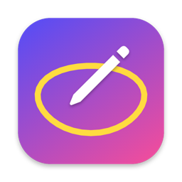
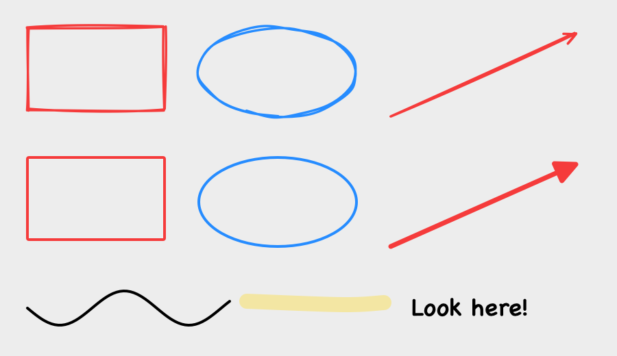

<p align="center">
  
</p>

<h1 align="center">Draw IO</h1>

<p align="center">
  Draw on your Mac's screen while you present: arrows, boxes, circles, highlighter and text.<br>
  Then screenshot the result and send it in seconds.
</p>

<p align="center">
  
  
  
</p>

---

## What is it?

When you're sharing your screen on a call or giving a presentation, it's hard to say "look at *this* bit". **Draw IO** is a small menu bar app that lets you draw straight on top of anything on your screen: slides, a browser, code or a dashboard.

- ✏️ **Pen** for freehand drawing
- 🖍️ **Highlighter**: a wide, see-through marker for pointing things out
- ⬜ **Boxes**, ⭕ **circles** and ➡️ **arrows**, each in a **hand-drawn** sketch style or a **clean, exact** style
- 🔤 **Text** in 7 fonts (Hand, Marker, Script, Sans, Rounded, Serif, Mono)
- 🎨 **8 colours** plus a custom colour picker, and **4 thicknesses**
- ⏱️ **Auto-fade**: drawings disappear after 2, 5, 10 or 30 seconds, which is perfect for quick pointers. Or set it to **Keep** so they stay on screen.
- 📌 **Keep all** stops everything on screen fading, 🧽 the **Eraser** deletes single drawings, and there's **Undo** and **Clear all**
- 📸 **Screenshot with your drawings**: choose an area or the whole screen. It's copied to your clipboard so you can paste it straight into Slack, Messages or email, with a **Share…** button for AirDrop, Mail and more.
- 🙈 **Your toolbar is invisible to viewers.** Screen shares and screenshots only show your drawings, never the controls.
- 🖥️ Works on **every display** and over **full-screen apps** (Keynote, PowerPoint, browsers)

<p align="center">
  
  <br><sub>Top row: hand-drawn style · Middle row: exact style · Bottom: pen, highlighter and text</sub>
</p>

## How to use it

1. Press **⌃⌥D** (Control + Option + D) from any app, or click the ✏️ icon in the menu bar and choose **Start Drawing**.
2. The toolbar appears at the top of the screen. Pick a tool and draw.
3. Press **Esc** when you're done. Your drawings stay on screen (until they fade), and your mouse goes back to working normally.

You can also open **Draw IO** from Applications, Spotlight or Launchpad at any time to start drawing.

### Keyboard shortcuts

**Anywhere on your Mac:**

| Shortcut | Action |
| --- | --- |
| **⌃⌥D** | Start / stop drawing |
| **⌃⌥S** | Screenshot an area (with your drawings) |
| **⌃⌥C** | Clear all drawings |

**While drawing:**

| Key | Action | | Key | Action |
| --- | --- | --- | --- | --- |
| **P** | Pen | | **1 – 4** | Thickness / text size |
| **H** | Highlighter | | **S** | Switch hand-drawn ↔ exact |
| **B** | Box | | **F** | Next font |
| **C** | Circle | | **K** | Keep everything on screen |
| **A** | Arrow | | **X** | Clear all |
| **T** | Text | | **⌘Z** | Undo |
| **E** | Eraser | | **Esc** | Stop drawing |

**Tips**
- Hold **Shift** while drawing a box or circle to make a perfect square or circle. Hold it with an arrow to snap to 45°.
- With the text tool, click where you want the text, type, then press **Return**. **Option-Return** starts a new line.
- Drag the grip on the left of the toolbar to move it.
- The fade setting applies to new drawings. Press **K** (📌) to keep what's already there.

### Screenshots

Click the 📷 button in the toolbar, press **⌃⌥S**, or use the menu bar icon. Choose an **area** (drag a box) or the **whole screen**. Draw IO then:

- copies the image to your clipboard, so you can paste it anywhere with **⌘V**
- saves a PNG to **Pictures → Draw IO**
- shows a pop-up with **Share…** (Messages, Mail, AirDrop, Slack…) and **Show** (opens it in Finder)

## Install guide

### Requirements

- A Mac running **macOS 14 Sonoma or later** (Apple Silicon or Intel)
- Apple's **Command Line Tools**, which are free and used to build the app

### 1. Install the Command Line Tools

Open **Terminal** (press ⌘ Space and type "Terminal") and run:

```bash
xcode-select --install
```

Click **Install** in the window that appears. If it says they're already installed, skip this step.

### 2. Download and build Draw IO

```bash
git clone https://github.com/luk3mp/draw-io.git
cd draw-io
./build.sh install
```

This builds the app, copies it to your **Applications** folder and opens it. Look for the ✏️ icon in your menu bar.

### 3. Allow screenshots (optional)

The first time you take a screenshot, macOS will ask for **Screen Recording** permission:

1. Open **System Settings → Privacy & Security → Screen Recording**.
2. Turn on **Draw IO**.
3. Quit Draw IO (menu bar icon → **Quit Draw IO**) and open it again from Applications.

You only need this for screenshots. Drawing on screen works without it.

> Each time you rebuild the app, macOS treats it as a new app, so you may need to turn Screen Recording on again after updating.

### 4. Open at login (optional)

Click the menu bar icon and tick **Open at Login**.

### Updating

```bash
cd draw-io
git pull
./build.sh install
```

### Uninstalling

Click the menu bar icon → **Quit Draw IO**, then drag **Draw IO** from Applications to the Bin. Screenshots are in **Pictures → Draw IO**.

## Troubleshooting

**The keyboard shortcuts don't work.** Another app may already be using ⌃⌥D, ⌃⌥S or ⌃⌥C. Quit the other app, or start drawing from the menu bar icon instead.

**Screenshots only show my wallpaper, or nothing happens.** Screen Recording permission is missing. See [step 3](#3-allow-screenshots-optional), and remember to reopen the app afterwards.

**Drawings don't show over a full-screen presentation.** Start drawing after the presentation is running. In Keynote, also turn on **Settings → Slideshow → Allow Mission Control, Dashboard and others to use screen**.

**The build fails.** Run `xcode-select --install` again and make sure macOS is up to date. `build.sh` already includes a workaround for a known Command Line Tools bug that causes `redefinition of module 'SwiftBridging'` errors.

## How it works

- Each display gets a transparent, borderless window at status-bar level that shows on every Space and over full-screen apps. While you're drawing, it catches the mouse. When you stop, it ignores the mouse, so clicks pass straight through to the apps underneath.
- The toolbar is a non-activating panel, so clicking it doesn't take focus from your presentation. It uses `NSWindow.sharingType = .none`, which hides it from screen sharing and screenshots.
- The hand-drawn style draws each line twice with small, seeded random wobbles. The seed is fixed per shape, so a shape looks the same every time it's redrawn.
- Global shortcuts use Carbon hot keys, which don't need Accessibility permission.
- Screenshots use macOS's built-in `screencapture` tool.

### Project layout

```
Sources/DrawIO/
  DrawIOApp.swift    App entry point and menu bar menu
  Controller.swift   State, tools, fading, undo, hot keys, screenshots
  Overlay.swift      Transparent per-screen windows; mouse, keyboard and text input
  Shape.swift        Shape model and rendering (hand-drawn + exact styles)
  Toolbar.swift      Floating toolbar and screenshot pop-up (SwiftUI)
Resources/           Info.plist and app icon
Tools/MakeIcon.swift Generates the app icon
build.sh             Builds (and optionally installs) the app
```

There's no Xcode project and no dependencies: `build.sh` calls `swiftc` directly.

## Contributing

Issues and pull requests are welcome. Ideas: a laser-pointer mode, a spotlight that dims everything except an area, filled shapes, and moving or resizing existing drawings.

## License

[MIT](LICENSE)
